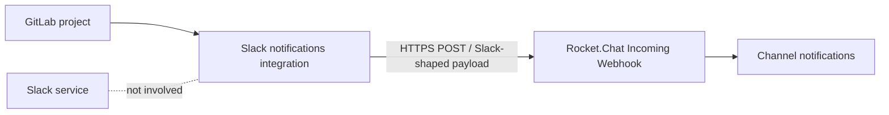

# GitLab notifications in Rocket.Chat — without Slack

> **No Slack account. No middleware. Just GitLab → Rocket.Chat.** 🚀

[](#local-validation) [](LICENSE) [](docs/it.md)

**A beginner-friendly walkthrough** for forwarding GitLab events into a Rocket.Chat channel, using the **legacy GitLab “Slack notifications”** integration and a **Rocket.Chat Incoming Webhook**. You don't need to install or subscribe to Slack.

The compatibility path was **verified end to end on a self-managed GitLab instance**: an actual GitLab *Test settings* notification arrived in Rocket.Chat. Your GitLab/Rocket.Chat versions and configuration may behave differently.

> [!WARNING]
> **Compatibility trick, not a forever API.** GitLab deprecated **Slack notifications** in **15.9** and hides it for some previously unconfigured projects in **19.5**. For new or long-lived deployments, see the [native GitLab Webhooks alternative](docs/native-webhooks.md). This repository documents a *working path*, not a promise of long-term support.

## Architecture



## 5-minute quickstart

### 1 — Create a bot user in Rocket.Chat

Open **Manage → Workspace → Users** and create or choose a dedicated account such as `gitlab-bot`.

- Ensure it exists, is active, and belongs to the target channel, e.g. `#dev-notifications`.
- In **Manage → Workspace → Permissions**, verify that its role has **`message-impersonate`**. Rocket.Chat requires this when the integration uses impersonation features.
- Prefer a minimally privileged bot to an administrator account.

### 2 — Create a Rocket.Chat Incoming Webhook

Go to **Manage → Workspace → Integrations → New → Incoming**, and set:

| Setting | Example |
| --- | --- |
| Enabled | On |
| Name | GitLab Notifications |
| Post to Channel | `#dev-notifications` |
| Post as | `gitlab-bot` (real existing username) |
| Alias | `GitLab` (optional display label) |
| Script Enabled | **Off** for this compatibility method |
| Allow override destination channel | **Off** unless explicitly needed |

Save. Copy the generated webhook URL into your password manager. **Treat the entire URL as a credential.** Never commit it, paste it in an issue, or include it in screenshots.

### 3 — Test Rocket.Chat *independently* of GitLab

Run from your machine:

```bash
bash scripts/test-webhook.sh
```

The script prompts for your webhook URL without echoing it, sends [`examples/payload.json`](examples/payload.json), prints the HTTP response status, and does not write the URL to disk. Expect an HTTP 2xx response **and a message in the channel**. This validates only the Rocket.Chat side.

### 4 — Allow outbound access on GitLab Self-Managed (if needed)

If GitLab says:

```text
Webhook is blocked: Requests to the local network are not allowed
```

its SSRF defense has likely stopped the request because the webhook hostname resolves to a private IP.

As a **GitLab administrator** open **Admin → Settings → Network → Outbound requests**. In **Local IP addresses and domain names that hooks and integrations can access**, allow only the necessary endpoint, ideally restricted to HTTPS:

```text
chat.example.internal:443
```

Keep **Allow requests to the local network from webhooks and integrations** disabled globally, and keep **Enforce DNS-rebinding attack protection** enabled. Don't allow `192.168.0.0/16` or the entire LAN. If the address is resolved inside Docker, verify the destination DNS and routing *from the GitLab container*, too. See [Troubleshooting](docs/troubleshooting.md).

### 5 — Configure GitLab Slack notifications

Navigate to **Project → Settings → Integrations → Slack notifications**:

| Setting | Value |
| --- | --- |
| Active | On |
| Webhook | **Your Rocket.Chat Incoming Webhook URL** |
| Username | `GitLab` (optional) |
| Triggers | Merge request, Issue, Pipeline, Deployment, etc. |
| Channel overrides | Leave blank to use the Rocket.Chat integration's destination |
| Notify only broken pipelines | Consider enabling to reduce noise |
| Notify only when status changes | Consider enabling |

**Save changes**, then click **Test settings** (or use the available test action on your GitLab version). Confirm that the message reaches Rocket.Chat. Only that final test validates the full path.

> [!TIP]
> **Project → Group → Instance:** GitLab supports configuring Slack notifications at these levels. For many projects, consider a group-level integration instead of duplicating configuration everywhere. Check inherited settings before enabling both, or you may get duplicates.

## Success checklist

- [ ] A normal HTTPS `curl` POST arrives in the Rocket.Chat room.
- [ ] `Post as` refers to a real user with channel membership and `message-impersonate` permission.
- [ ] GitLab outbound policy allows *only the needed destination* (if it resolves privately).
- [ ] The GitLab integration saves without a blocked-webhook error.
- [ ] **GitLab Test settings** creates a real Rocket.Chat message.
- [ ] A real merge request / pipeline event sends the expected notification.
- [ ] The webhook URL is stored securely and has never appeared in version control.

## Troubleshooting

| Symptom | Likely cause | Fix |
| --- | --- | --- |
| `Invalid user [error-invalid-user]` | Invalid `Post as` user | Create the user or set a valid username |
| `The user must exist and have the message-impersonate permission` | Missing bot permission / membership | Verify role permissions and channel membership |
| `Webhook is blocked: Requests to the local network are not allowed` | GitLab SSRF guard blocks private destination | Allowlist the specific hostname and port as admin |
| `curl` works, GitLab fails | Different DNS, routing, or outbound policy | Test from GitLab container and check outbound settings |
| HTTP 200 but no visible message | Wrong channel, integration, or formatting | Check Rocket.Chat channel and integration logs |
| Slack notifications is missing | Deprecated/hidden integration | Use [native GitLab Webhooks](docs/native-webhooks.md) |

Full diagnosis: [docs/troubleshooting.md](docs/troubleshooting.md).

## Native alternative for new deployments

**GitLab project/group Webhooks → Rocket.Chat Incoming Integration with a GitLab event transformation script**. It avoids relying on the deprecated Slack notifications interface and is documented by Rocket.Chat. See [docs/native-webhooks.md](docs/native-webhooks.md). It needs an integration script; simply pointing GitLab's raw JSON at a scriptless Rocket.Chat incoming webhook is *not* equivalent.

## Local validation

```bash
bash -n scripts/*.sh
python3 -m unittest discover -s tests -v
```

No dependencies for repo tests. Only `bash` and `curl` are required to send the live webhook test.

## Documentation / sources

- [GitLab — Slack notifications (deprecated)](https://docs.gitlab.com/user/project/integrations/slack/)
- [GitLab — Filtering outbound requests](https://docs.gitlab.com/security/webhooks/)
- [Rocket.Chat — Incoming Integrations](https://docs.rocket.chat/docs/integrations)
- [Rocket.Chat — GitLab native Webhooks](https://docs.rocket.chat/docs/gitlab)

## Security and credits

This is an **independent community guide**, not an official GitLab, Rocket.Chat, or Slack project. No tokens, internal server addresses or private infrastructure details are bundled. Found a security issue? See [SECURITY.md](SECURITY.md).

Made by **CodeCorn Technology** — documenting the errors we hit so you don't have to. 🌽

[🇮🇹 Leggi la guida italiana](docs/it.md) · [Troubleshooting](docs/troubleshooting.md) · [License](LICENSE)
