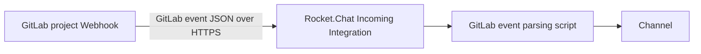

# Durable alternative: GitLab Webhooks → Rocket.Chat

The primary tutorial covers a **legacy compatibility route** that relies on GitLab's deprecated **Slack notifications** integration. If that integration is missing, or you're deploying something intended to last for years, prefer native **GitLab Webhooks**.

## Topology

## Officially documented setup

1. Create a Rocket.Chat **Incoming Integration** (enable it, choose a channel, and use a valid `Post as` user with the necessary permission).
2. Switch **Script Enabled** to **ON** and use the **GitLab event parsing script** from [Rocket.Chat's GitLab integration documentation](https://docs.rocket.chat/docs/gitlab). Don't confuse this with the *scriptless* Slack-compatible path.
3. In GitLab, open **Project → Settings → Webhooks** and set the destination to the Rocket.Chat Incoming Integration URL.
4. Select the events you want to receive (issues, merge requests, pushes, etc.), and test delivery.
5. For Rocket.Chat installed on a private network, use the same **narrow GitLab outbound allowlist** described in the main README.
6. Validate a real event, not just a manual HTTP POST.

> [!NOTE]
> The linked Rocket.Chat script is maintained in official documentation. This repository intentionally **does not copy/fork** that large formatter: versions and event payload shapes evolve, and an outdated copy can break or leak sensitive event data. Review the script, validate its handling of confidential issues, and pin a tested version internally if you need production change control.

## Differences

| | Legacy Slack notifications route | Native GitLab Webhooks |
| --- | --- | --- |
| Slack account needed | No | No |
| Third-party relay needed | No | No |
| Rocket.Chat script needed | No (script off) | **Yes** (event formatter) |
| Deprecation concern | **Yes** | Preferred approach |
| Setup in GitLab | Settings → Integrations → Slack notifications | Settings → Webhooks |

### Sources

- [Rocket.Chat GitLab guide](https://docs.rocket.chat/docs/gitlab)
- [GitLab Slack notifications lifecycle](https://docs.gitlab.com/user/project/integrations/slack/)
- [GitLab webhook event docs](https://docs.gitlab.com/user/project/integrations/webhook_events/)
